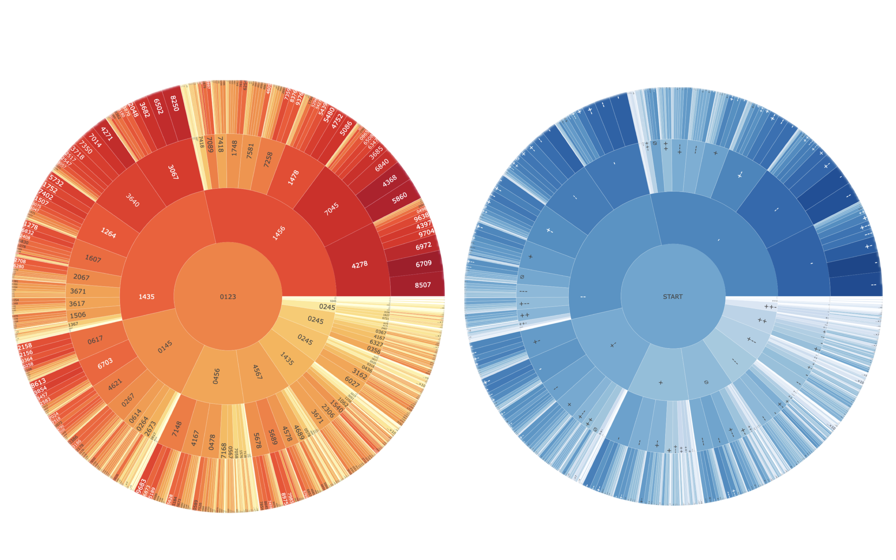
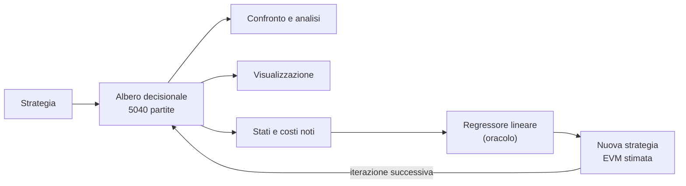
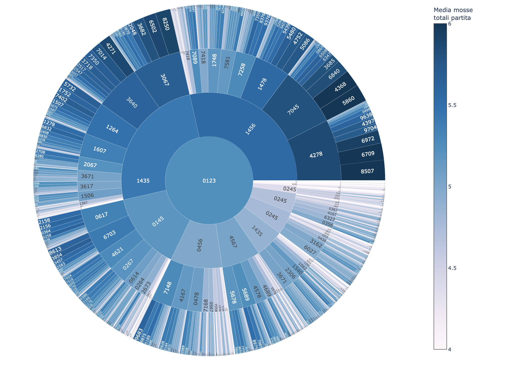
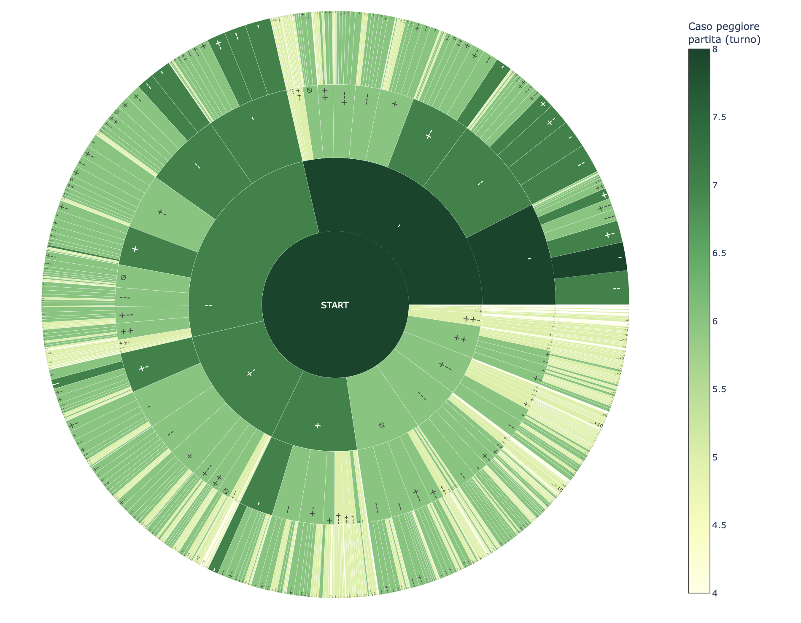
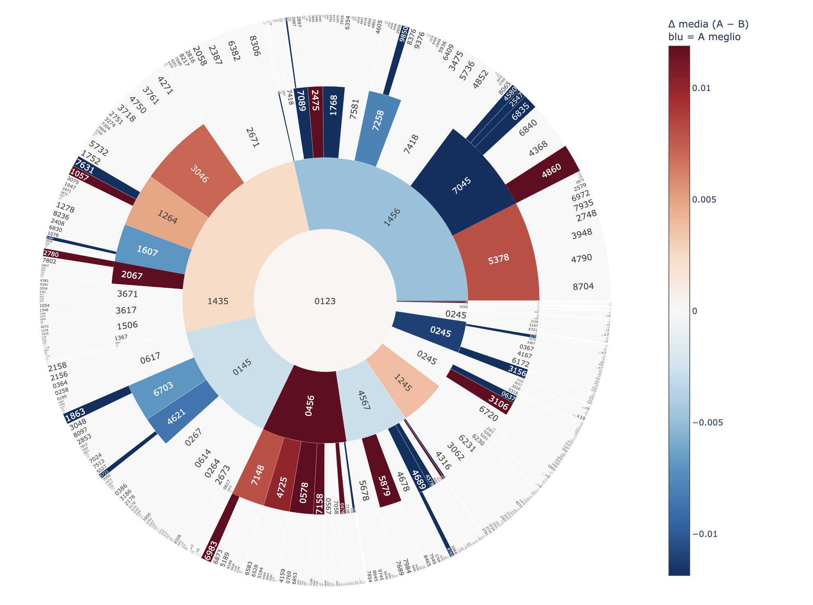

# Cows and Bulls Solver

Un laboratorio per studiare Cows and Bulls (Mastermind a 4 cifre distinte): una collezione di strategie, gli strumenti per misurare le performance su tutte le 5040 partite possibili e per guardarne gli alberi decisionali.



## Com'è nato

La domanda da cui parte il progetto è: **quanto può essere buona una strategia greedy?** Una strategia greedy sceglie la mossa guardando solo un passo avanti, valutando come quella mossa divide le soluzioni ancora possibili. Non calcola in anticipo un albero decisionale perfetto da seguire mossa per mossa: a ogni turno decide sul momento, in base alle soluzioni che restano.

Ogni strategia viene giudicata con due numeri: **media delle mosse** e **caso peggiore**.

## Cosa contiene

| Parte | Cosa fa | Dove |
|---|---|---|
| **Strategie** | Naive, frequenze, entropia, minimax semplice, ibridi pesati, EVM esatta, EVM stimata, router per stato, ricetta "Frankenstein" | `src/strategies/` |
| **Generazione di alberi** | Crea l'albero decisionale completo e lo salva in JSON | `scripts/generate_trees.py` |
| **Analisi** | Confronto tra alberi (media, caso peggiore, distribuzione dei turni, ramo per ramo), autopsia di un ramo, invarianza rispetto alla prima mossa | `scripts/compare_trees.py`, `experiments/investigate_branch.py`, `experiments/first_move_invariance.py` |
| **Visualizzazione** | Sunburst, icicle e treemap interattivi degli alberi, con confronto tra due strategie | `scripts/visualize_tree.py` |
| **Laboratorio dei regressori lineari** | Estrae gli stati dagli alberi, calcola feature, seleziona soglie e feature per fase, addestra e valuta i modelli (OLS ed expectile) | `experiments/oracle_lab/` |
| **Pipeline** | Orchestra un'iterazione del laboratorio in stadi, con manifest e skip idempotente | `scripts/run_pipeline.py` |
| **Tuning e router** | Ricerca dei pesi degli ibridi; programmazione dinamica per scegliere la strategia stato per stato | `experiments/tune_*.py`, `experiments/train_policy_router.py` |

> Le strategie condividono un'unica interfaccia (`BaseStrategy`): per aggiungerne una basta implementare `evaluate_candidates` e registrarla in `src/strategies/zoo.py`.



## Quick start

Serve Python 3.10 o superiore.

```bash
python -m venv venv
source venv/bin/activate
pip install numpy tqdm plotly
pip install pytest ruff
python -m pytest
```

Tutti i comandi si lanciano dalla radice con `python -m ...`; il progetto non si installa come pacchetto.

## Giocare contro il solver

Giocare non è la funzione principale: il progetto serve a calcolare e confrontare strategie, e la partita è solo un modo rapido per provarle.

```bash
python main.py --list
python main.py --strategy max_entropy                 # partita interattiva
python main.py --strategy max_entropy --secret 9835   # partita automatica
```

In modalità interattiva si risponde con `+` per ogni toro, `-` per ogni mucca, `0` per nessuna corrispondenza, `q` per uscire.

> **Prima di partire.** Il programma costruisce la tabella dei feedback di tutte le coppie (la stessa che serve per le analisi): qualche decina di secondi e circa 1 GB di RAM.

### Quali strategie sono disponibili

Le strategie sono codice: quelle "base" funzionano appena cloni il repository. Gli **alberi** invece non sono salvati nel repository: si generano con `generate_trees` (vedi sotto). Alcune strategie, inoltre, hanno bisogno di file prodotti dalla pipeline o da altri script, che si trovano in `data/runs/iter_00/models/`.

| Strategia | Cosa serve |
|---|---|
| `naive`, `max_frequency`, `greedy_minimax`, `max_entropy` | Niente |
| `hybrid_entropy_minimax` | Niente (i pesi 0.94 / 0.06 sono fissi nel codice) |
| `estimated_evm_legacy` | Niente (coefficienti fissi nel codice) |
| `estimated_evm_geometric`, `estimated_evm_piecewise`, `hybrid_evm_minimax`, `hybrid_geometric_minimax` | Usano il modello in `models/` se esiste; altrimenti ripiegano sui coefficienti legacy, con un avviso |
| `estimated_evm_selected` | `models/selected.json`, prodotto da `select_model` (parte della pipeline) |
| `hybrid_best_minimax` | `models/hybrid_best.json`, prodotto da `tune_best_hybrid` |
| `router_a_strategy`, `router_d_strategy` | `models/routing_policy.json`, prodotto da `train_policy_router` |
| `frankenstein_a_strategy`, `frankenstein_d_strategy` | `models/recipe.json`, prodotto dallo stesso script del router |

Router e Frankenstein scelgono la mossa stato per stato tra più strategie; la versione "Frankenstein" funziona anche con una prima mossa diversa. Non fanno parte della pipeline: si generano a mano con `train_policy_router`. `python main.py --list` mostra quelle effettivamente disponibili.

Esempio:
```bash
> python main.py --strategy max_entropy --secret 9876
Sistema pronto (16.0 s)
--- Strategia: max_entropy ---
1. 0123 -> 0
2. 4567 -> --
3. 5689 -> ---
4. 8975 -> +--
5. 8796 -> +---
6. 9876 -> ++++
Risolto in 6 tentativi
```

## Generare e confrontare gli alberi

```bash
python -m scripts.generate_trees --strategies max_entropy greedy_minimax hybrid_entropy_minimax
python -m scripts.compare_trees --dir data/runs/iter_00/trees
python -m scripts.compare_trees --dir data/runs/iter_00/trees --branches
```

> `generate_trees` salva un file JSON per strategia in `data/runs/iter_00/trees/` (la cartella cambia con `COWS_RUN_DIR`), e salta gli alberi già presenti a meno di `--force`. Servono circa 2 minuti per l'albero di una strategia greedy a profondità 1.

`--branches` ripete il confronto per ogni feedback del primo turno, con turni relativi al sotto-albero: è un modo rapido per vedere *dove* due strategie divergono.

```bash
> python -m scripts.compare_trees --trees max_entropy naive max_frequency

==================================================================================
 CONFRONTO STRATEGIE 
==================================================================================
Strategia                    | Caso peggiore | Media mosse
----------------------------------------------------------
max_entropy                  | 8             | 5.24286    
max_frequency                | 8             | 5.41647    
naive                        | 9             | 5.56032    

Strategia                    | T1    | T2    | T3    | T4    | T5    | T6    | T7    | T8    | T9   
-----------------------------------------------------------------------------------------------------
max_entropy                  | 1     | 5     | 62    | 611   | 2483  | 1779  | 98    | 1     | 0    
max_frequency                | 1     | 13    | 108   | 615   | 1881  | 1893  | 507   | 22    | 0    
naive                        | 1     | 13    | 108   | 596   | 1668  | 1768  | 752   | 129   | 5 
```


## Vedere gli alberi

`visualize_tree` trasforma un albero in una figura interattiva (HTML). Ogni nodo è uno spicchio o un rettangolo:

- l'**area** è proporzionale al numero di soluzioni rimaste;
- il **colore** indica quanto costa chiudere la partita da quel punto in poi, in media oppure nel caso peggiore.

```bash
python -m scripts.visualize_tree max_entropy
```

> **Dove cerca gli alberi.** `visualize_tree` legge da `data/trees_to_draws/`, non da `data/runs/iter_XX/trees/`, dove scrive la pipeline. Le due cartelle sono separate di proposito: la prima contiene tutti gli alberi di un'iterazione, la seconda solo quelli che vuoi disegnare. Per visualizzare un albero, copialo in `data/trees_to_draws/`.


### Una strategia, con i nodi colorati per media delle mosse

<!-- TODO: assets/sunburst_max_entropy.png -->


```bash
python -m scripts.visualize_tree max_entropy --kind sunburst --color absolute
```

I rami più chiari si chiudono presto; quelli scuri sono dove le partite si allungano.

### I casi peggiori

<!-- TODO: assets/sunburst_max_entropy_worst.png -->

```bash
python -m scripts.visualize_tree max_entropy --kind sunburst --metric worst --label feedback
```

### Due strategie a confronto

Passando due alberi, il colore mostra la differenza di costo dello *stesso stato* nei due alberi: blu dove vince la prima, rosso dove vince la seconda, bianco dove pareggiano.

<!-- TODO: assets/delta_entropy_vs_evm.png -->


```bash
python -m scripts.visualize_tree max_entropy estimated_evm_geometric
```

Le due strategie hanno un numero medio di mosse molto simile alla radice, ma le performance cambiano a seconda del feedback ricevuto: i colori mostrano in quali rami vince l'una e in quali l'altra.

## Il laboratorio dei regressori

Per le strategie EVM stimate serve un oracolo: un modello che stimi quanto costa chiudere un insieme di soluzioni. Il laboratorio svolge i seguenti passi:

1. **Estrarre** gli stati dagli alberi, con il miglior costo noto per ciascuno (`data_miner`, `augment_states`).
2. **Raffinare** i costi: esatti per gli stati piccoli, mini-torneo tra strategie per quelli medi (`dataset_refiner`).
3. **Calcolare le feature** di ogni stato: `log_n`, entropia per colonna, deviazione standard delle cifre, ecc. (`feature_builder`).
4. **Selezionare** soglie su N e feature di ogni fase con programmazione dinamica e cross-validation (`select_model`), oppure addestrare modelli a soglie fisse (`train_model`).
5. **Valutare** con il regret rispetto all'ottimo esatto (`evaluate_regret`).
6. **Rigiocare**: i modelli diventano strategie, i loro alberi alimentano l'iterazione successiva.

```bash
python -m scripts.run_pipeline --iter 0 --dry-run     # cosa farebbe
python -m scripts.run_pipeline --iter 0               # esegue (richiede tempo)
```

Un limite da tenere presente: il modello si allena sui risultati di strategie già note. Il suo punto di partenza è il loro livello, non l'ottimo.

## Struttura

```
main.py            partita interattiva o automatica
src/
  core/            feedback, generatore, tabella dei feedback, stato
  strategies/      tutte le strategie e lo zoo che le costruisce per nome
  estimators/      stimatori del costo di un bucket
  features/        registro delle feature
  analysis/        costruzione, salvataggio e metriche degli alberi
  cli/             ciclo di gioco da terminale
scripts/           generazione alberi, confronto, visualizzazione, pipeline
experiments/       laboratorio dei regressori, router, tuning, diagnostica
tests/             suite pytest
data/              alberi, modelli e dataset generati (non nel repository: si creano in locale)
```